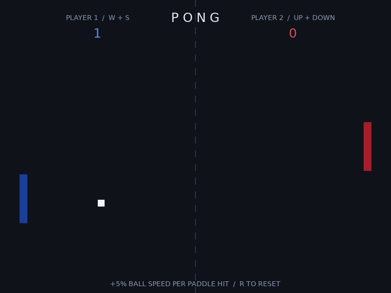

# Pong in LÖVE2D

**Name:** Yahya Abu Alasab  
**Class/section:** To be supplied

A two-player Pong game built with Lua and LÖVE2D. Players share one keyboard and move rectangular paddles to keep a ball in play. The ball starts in the middle, bounces off the top and bottom walls, and reverses direction when it hits a paddle. Paddles stay inside the window, and a missed ball automatically returns to the center for another rally. Movement uses elapsed time so the game runs at the same speed across different frame rates.

## Run

Install [LÖVE 11.5](https://love2d.org/), open a terminal in this project folder, and run:

```sh
love .
```

## Controls

| Action | Key |
| --- | --- |
| Left paddle up / down | W / S |
| Right paddle up / down | Up / Down arrow |
| Reset paddles, ball and scores | R |

## My own change

Each paddle has a different color: dark blue for Player 1 (left) and dark red for Player 2 (right).

The score is shown at the top in each player's color. When the ball leaves the left side, Player 2 earns one point; when it leaves the right side, Player 1 earns one point. Paddle hits and wall bounces do not award points. The ball returns to the center after each point, and R resets both scores to zero.

After every paddle hit, both velocity components of the ball increase by 5%. This makes a rally progressively harder while keeping the same bounce angle. The total speed is capped at 850 pixels per second to keep the game playable, and each new rally restores the starting speed.

## Screenshot



## Short demo

[Watch or download the gameplay video (MP4)](demo/gameplay.mp4)

The screenshot and demo show a real gameplay session controlled manually with W/S and the arrow keys, recorded from the running LÖVE game.
